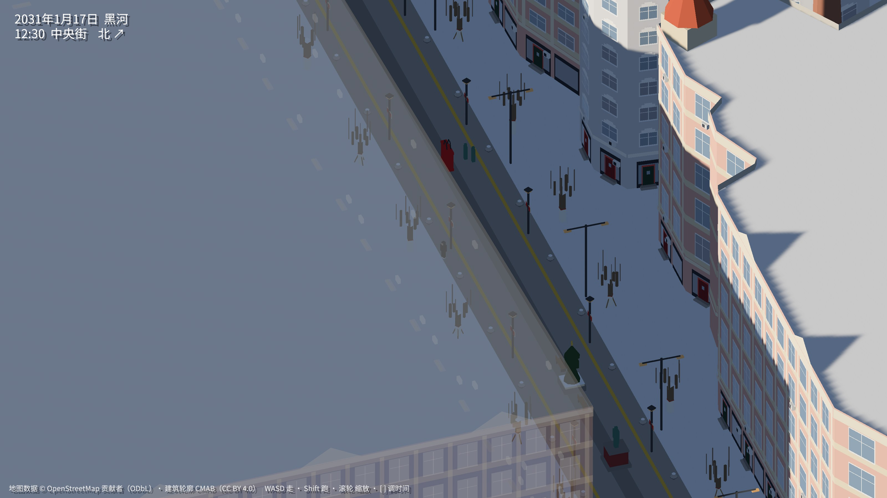
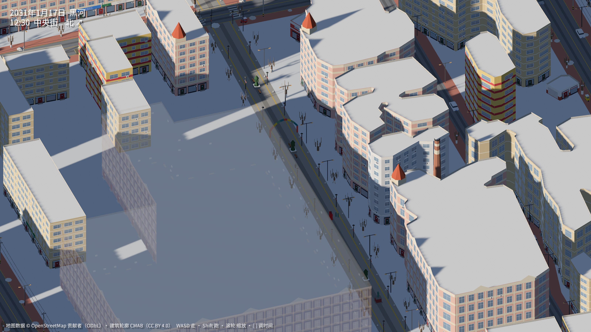
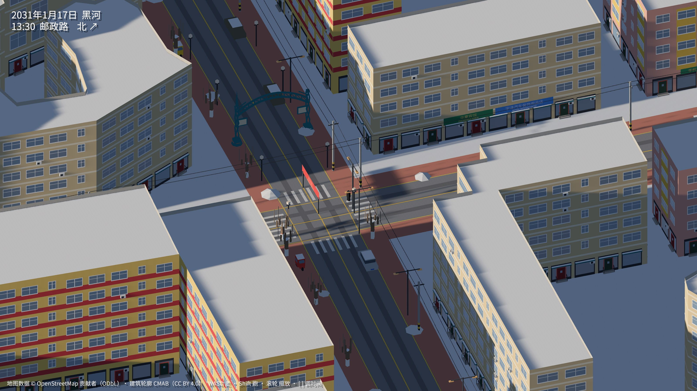
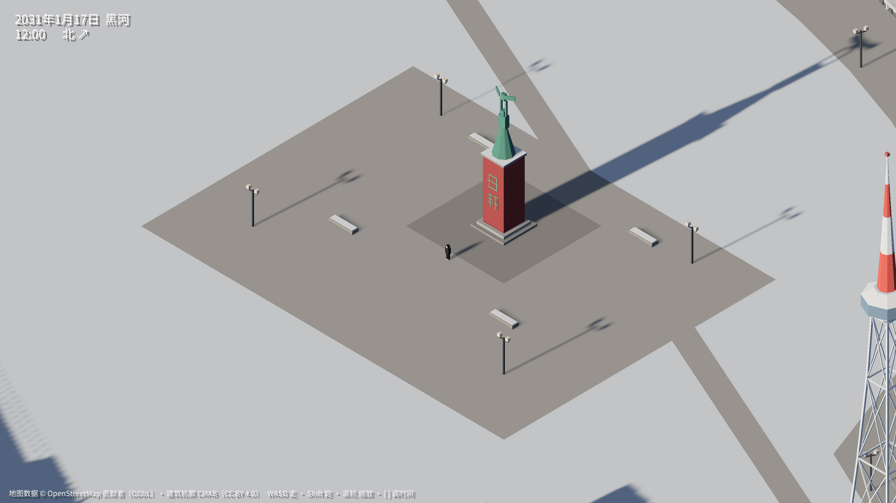
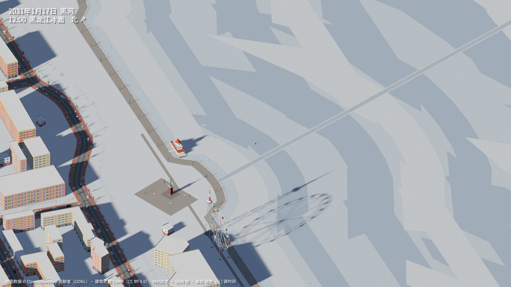
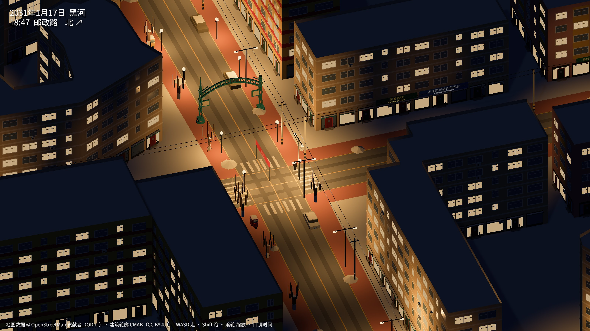
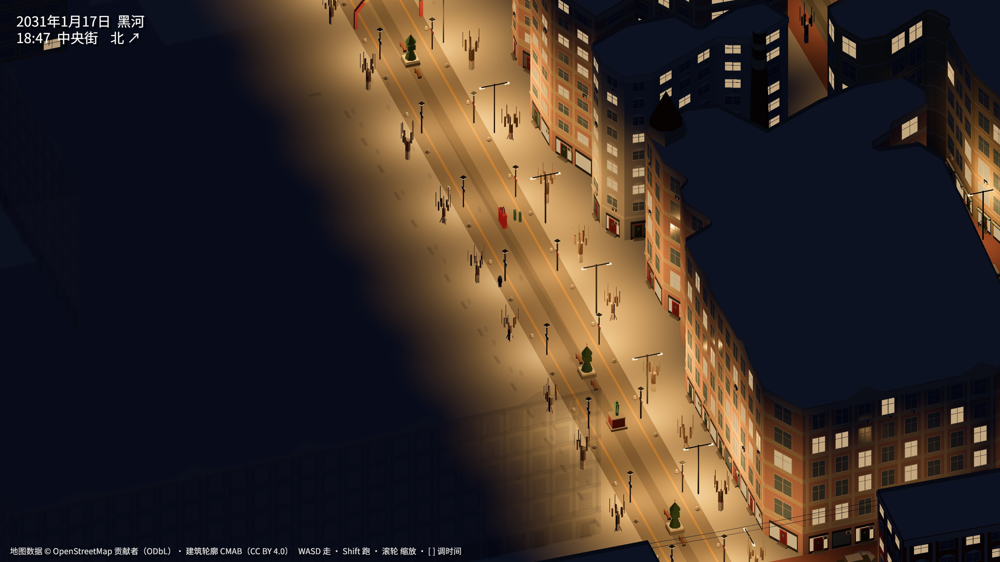
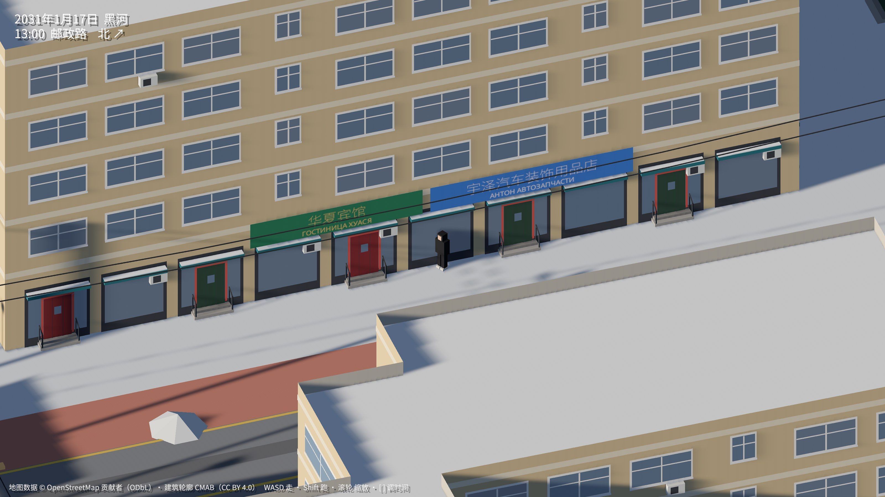
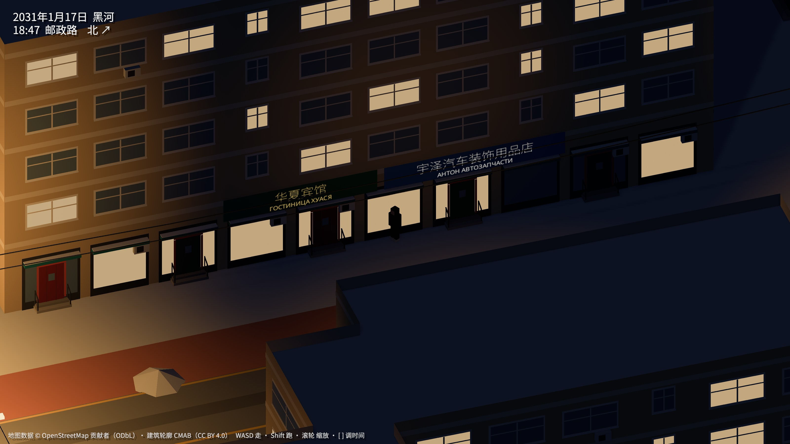

# Heihe R4 Streetscape & Landmark Polish Receipt

Branch: `claude/rust-heihe`  
Target hardware: Intel Core Ultra 7 258V / Intel Arc 140V GPU (Vulkan, Windows 11, 1920x1080)  
Date: 2026-11-18  

---

## 1. Photo-Sourced Palette (`data/heihe/look.json`)

Added 5 Wikimedia Commons photograph citations under `meta.photos` matching references in `out/ref/`:

- `street-night-3`: `Streets of Heihe 04.01.2026 (3).jpg` (winter door curtains, doorway banners, AC outdoor units, whitewashed lower tree trunks)
- `street-night-4`: `Streets of Heihe 04.01.2026 (4).jpg` (concrete utility poles with black/yellow warning bands, overhead wires, enclosed three-wheelers)
- `pushkin`: `普希金书店2017.jpg` (Pushkin bronze statue on dark-red granite plinth, paired red circular medallions on lamp posts)
- `memorial`: `黑河旅俄华侨纪念馆街景 2025-10-12.jpg` (rose-red facade with white quoins on Wangsu Street, staked whitewashed trees, yellow kerb lines)
- `river-wheel`: `Blagoveshchensk, Russia --- Heihe, China (8789486307).jpg` and `Blagoveshchensk, Russia Heihe, China (8799506204).jpg` (white riverside Ferris wheel, steel lattice TV tower, red-roofed white tourist boat pavilion)

Added 19 photograph-traced colours (every key verified by `every_colour_names_its_photograph`):

- `walls`: `memorial_rose` (`#C83E6B`), `curtain_green` (`#253B2F`), `curtain_maroon` (`#6E2226`), `ac_white` (`#D8DBD8`), `awning_teal` (`#1B626B`)
- `ground`: `tactile_yellow` (`#C9A538`)
- `props`: `tree_lime` (`#E6E6E0`), `tree_stake` (`#8C7355`), `medallion_red` (`#B82928`), `topiary_green` (`#2F4A2E`), `bag_red` (`#B51F24`), `bench_wood` (`#7A5234`), `chimney_brick` (`#8B5A46`), `trike_teal` (`#287C78`), `camo_cover` (`#5E5B4A`), `pole_concrete` (`#8E908E`), `wire_dark` (`#26282B`), `wheel_white` (`#E8ECF0`), `rail_iron` (`#2B2E32`)

---

## 2. Geometry & Environment Upgrades

### Facades & Shopfronts (`crates/sim/src/facade.rs`, `crates/sim/src/scene.rs`)
- **Corrugated shutter slats** on closed `LowBrick` shopfront bays.
- **Northeast quilted winter door curtains** (`curtain_green` / `curtain_maroon`) with vertical stitch ribs, eye-level viewing panes, and red New Year/shop doorway couplets.
- **Granite entrance steps & iron handrails** on `TanTile` and `LowBrick` shop doors.
- **Projecting canopies** (`awning_teal` / `baroque_red`) crowned with thin snow trim at `2.62–2.82 m`, and wall-mounted **shop boards** lifted to `3.55 m` (`2.925–4.175 m` height span) so bilingual signage clears awnings and ground AC units without overlap.
- **Outdoor AC units** mounted cleanly on brackets on ground-floor bays and upper window aprons, plus window horizontal transom bars and snow sills.

### Streets, Trees & Vehicles (`crates/sim/src/scene.rs`)
- **Paving & road markings**: Tactile yellow blind strips along pedestrian/major kerbs, yellow roadside lines, 7 major street crosswalks (`(-139.5, -256.1)` etc.), and a cleared winter vehicle/pedestrian crossing track across the frozen Heilongjiang.
- **Trees**: Lime-whitewashed lower trunks (`tree_lime`), terracotta/brick root collars, and wooden tripod winter stakes (`tree_stake`).
- **Overhead utility network**: Concrete poles with black-and-yellow warning bands and sagging catenary overhead wires (`Soup::beam`).
- **Vehicles**: Winter camo tarpaulin car covers (`camo_cover`) and enclosed three-wheelers (`trike_red`, `trike_teal`, `trike_yellow`) parked at kerbs.

### Heihe Landmarks (`crates/sim/src/scene.rs`)
- **Central Street (`中央街`)**: Paired red circular lamp-post medallions, tiered onion-dome topiary towers with wooden benches, Pushkin statue at `(-228.0, -333.5)`, hollow red shopping bag sculpture + companion figures at `(-272.0, -311.5)`, four-colour rainbow arch at `(-316.0, -289.5)`, and 32 m octagonal red brick chimney near the classical building at `(-248.0, -286.0)`.
- **Russian Goods Street (`俄罗斯商品街`)**: Twin teal helical-column iron arches with cream inward plaques and needle spires across 文化街 `(-159.3, -246.5)` and 海兰街 `(-116.4, -156.4)`, flanked by white-globe black lamps.
- **Mother Square (`母亲广场`)**: Dark-red granite plinth with engraved green `母親` vertical characters (`mother_characters`), square perimeter granite benches, and twin-globe plaza lamps.
- **Heilongjiang Riverfront**: Continuous embankment stone balustrade with red emblem plaques along `offset(&city.bank, 0.9)`, promenade twin-globe lamps, pushed river-ice pressure blocks, the 50 m white Ferris wheel with coloured cabins at `(105.0, -35.0)`, the 58 m red-and-white steel lattice TV tower at `(75.0, -20.0)`, and the red-spired white tourist boat pavilion moored at `(-48.0, 58.0)`.

### Spatial Chunking (`crates/sim/src/soup.rs`, `crates/game/src/main.rs`)
- Added `Soup::beam` (outward-normal 4-sided structural beams/cables) and `Soup::chunks(120.0)` (120 m × 120 m spatial grid binning by triangle centroid).
- Updated `crates/game/src/main.rs` to spawn `scene.props.chunks(120.0)` and `scene.lamp_glow.chunks(120.0)` as separate meshes for Bevy frustum culling.

---

## 3. Verification & Benchmarks

### Unit Tests (`cargo test -p sim`)
- `51 passed; 0 failed; 0 ignored` (0 compiler warnings).
- Includes new checks: `soup::tests::a_beam_faces_outward`, `soup::tests::chunks_keep_every_triangle`, and `tests::heihe_has_its_landmarks_and_winter_props` (verifying all 19 new `look.json` colour keys, `>= 20` prop chunks conserving every triangle, exact coordinates/heights of both teal arches, Ferris wheel, TV tower, brick chimney, boat pavilion, and continuous riverside balustrade).

### Geometry Tally (`cargo run -p sim --bin scene_report`)
- Chinese bank: `867` buildings (`2596` meshes, `6` crowns)
  - Walls and roofs: `1,910,255` triangles
  - Dark windows: `166,418` triangles
  - Lit windows: `120,334` triangles
- Far bank: `3,860` buildings, `0` glass, `10` lit triangles
- Ground: `5,078` triangles
- Props: `224,200` triangles (`66` chunks @ `120 m`)
- Lamp heads: `8,690` triangles (`55` chunks @ `120 m`)
- Street lamps: `682` heads on `451` posts
- Shop boards: `90`
- **Total scene triangles**: `2,439,025`

### Same-Session Frame Times: R3 Baseline vs R4 (`--shots`)
Measured with `chrome.exe --headless` count = `0` before and after, running 3 alternating passes (`out/r4/northeast-r3.exe` vs `target/x86_64-pc-windows-gnullvm/release/northeast.exe`, 24 frames per view per run, default window capture):

| View | R3 Mean (ms) | R4 Mean (ms) | Delta (ms) | R3 Median (ms) | R4 Median (ms) | R4 p95 Mean (ms) |
|---|---:|---:|---:|---:|---:|---:|
| `01_central_street_noon` | 15.6 | 16.6 | +1.0 | 15.7 | 16.1 | 24.2 |
| `02_central_street_wide` | 17.6 | 20.1 | +2.6 | 16.5 | 19.2 | 32.1 |
| `03_housing_noon` | 15.8 | 17.1 | +1.3 | 15.4 | 16.8 | 23.0 |
| `04_mother_square` | 13.7 | 14.1 | +0.4 | 13.3 | 14.1 | 20.8 |
| `05_river_and_far_bank` | 27.5* | 22.4 | -5.1 | 19.9 | 23.3 | 29.0 |
| `06_whole_town` | 25.7* | 29.3 | +3.6 | 21.4 | 28.7 | 34.8 |
| `07_central_street_dusk` | 23.4 | 28.9 | +5.5 | 23.1 | 29.0 | 33.6 |
| `08_housing_night` | 20.6 | 23.1 | +2.5 | 20.9 | 22.7 | 29.9 |
| `09_central_street_night` | 20.3 | 24.7 | +4.4 | 20.1 | 23.7 | 29.6 |
| `10_shop_boards_close` | 14.8 | 15.3 | +0.5 | 14.2 | 15.1 | 20.9 |
| `11_shop_boards_night` | 20.4 | 21.5 | +1.1 | 20.7 | 21.1 | 23.8 |

\* `r3-1` hit a cold-run spike on `05_river_and_far_bank` (`46.6 ms`) and `06_whole_town` (`35.1 ms`); comparing warmed third runs (`r3-3` vs `r4-3`), street views remain around `14.1–16.0 ms` (`01: 15.7 vs 16.0`, `03: 15.4 vs 15.5`, `10: 13.7 vs 14.8 ms`) while zoomed-out `06_whole_town` moves from `20.5` to `24.8 ms`.

---

## 4. Saved Showcase Screenshots (`docs/shots/rust-r4/`)

- 
- 
- 
- 
- 
- 
- 
- 
- 
