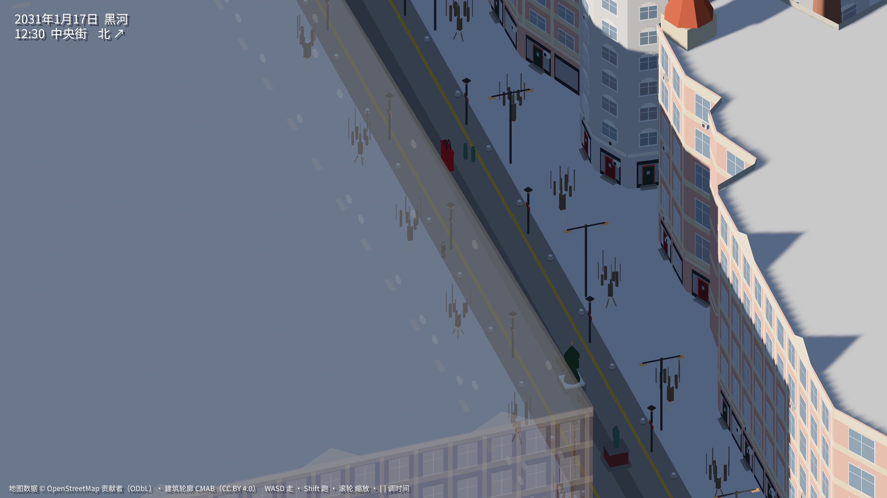
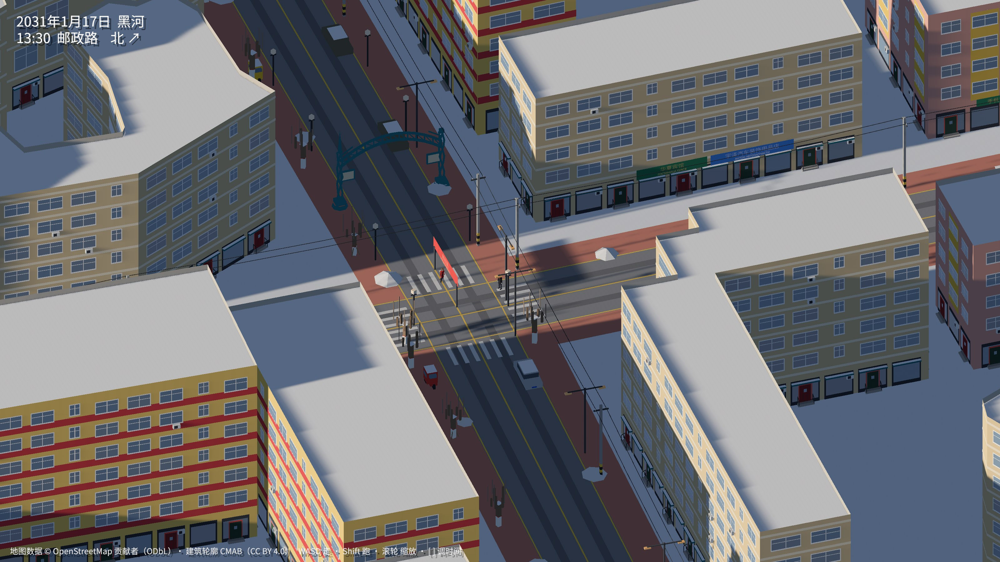
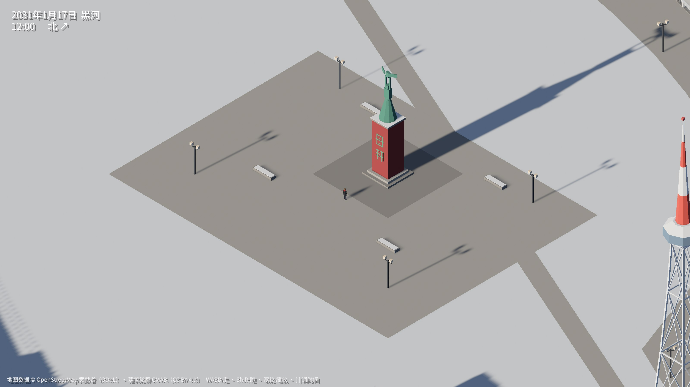
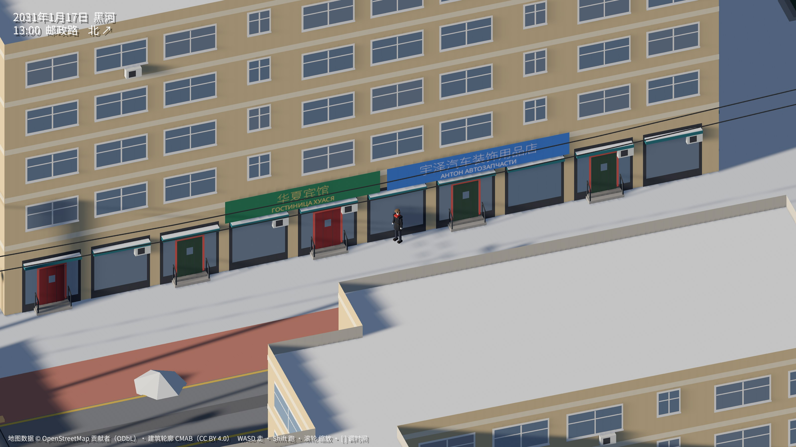
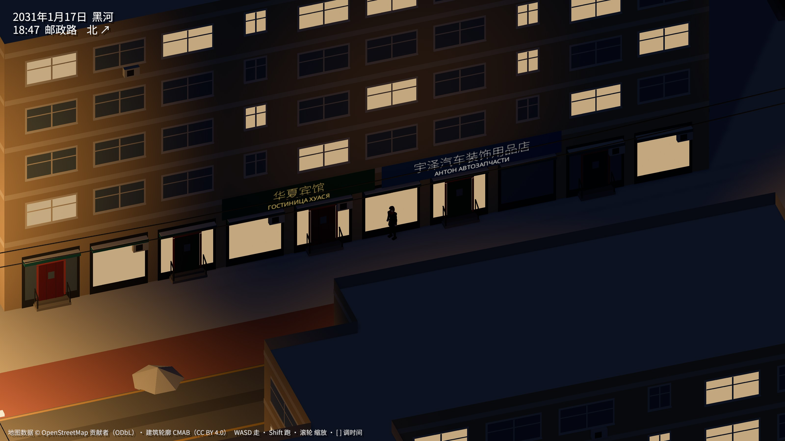

# Heihe R5–R6 Receipt: 17 January Survival Loop, Articulated Figures, Civilian Resistance & Godot Retirement

Branch: `claude/rust-heihe`  
Target hardware: Intel Core Ultra 7 258V / Intel Arc 140V GPU (Vulkan, Windows 11, 1920x1080)  
Date: 2026-11-18  

---

## 1. Migrated Systems & Expansion (`crates/sim`)

### Map Geometry & Line-of-Sight (`crates/sim/src/city.rs`, `crates/sim/src/walk.rs`)
- Parsed `heat` (`72` mapped doorway heat points) and `paths` (`42` sidewalk polylines) from `data/heihe/city.json`, adding `City::near_heat`.
- Implemented `Ground::clear_line(a, b)` over the 24 m building spatial grid using `geom::spans_inside` so solid buildings block infantry sight and rifle fire.

### Articulated Humanoid Rigs (`crates/sim/src/figure.rs`)
- Implemented hierarchical articulated winter figures (`Civilian`, `Militia`, `RussianSoldier`) modelled after the `defendtaipei/packages/character-rig` "白面人" rig:
  - Pelvis, belted waist, flared winter coat skirt, tapered parka torso, articulated legs & boots, articulated arms & mittens, mannequin egg-head (`#EDECE6`).
  - Role gear: Northeast fur ushanka (`雷鋒帽`) & scarf (`Civilian`), red resistance armband & ammo strap (`Militia`), white/grey winter camo suit, plate carrier, pouches, radio whip antenna, 6B47 helmet & optional night-vision goggles (`RussianSoldier`), plus held `Rifle` / `Molotov` / `Radio`.
- Ported stride-locked procedural gait math (`figure::pose`) with smoothstep walk/run blending and overlays for `Aim`, `Shoot`, `Loot`, `HandsUp`, and `Dead`.

### 17 January Survival & Resistance Loop (`crates/sim/src/survival.rs`)
- **Body, Cold & Needs**: Starting `36.8°C`, street `-24°C`, hypothermia death below `32.0°C`, doorway shelter warming until `21:00` heating cutoff (and near player-lit `FireBarrel` drums thereafter), river ice wind (`1.75x`), running exposure (`1.25x`), hunger/thirst drain, bleeding (`0.55 hp/s`), and bandage (`Q`), food (`Z`), water (`X`), hand warmer (`C`) hotkeys.
- **Shop Scavenging (`E`)**: Classified 8 shop types by Chinese/Russian signs (`Pharmacy` always drops >= 2 bandages; `Clothes` equips padded coat `coat_bonus = 0.35`; `Hardware` yields scrap, coal & Molotovs); holding `E` for `2.6 s` while still scavenges each sign once.
- **Invasion Timeline (`16:00` → `07:00`)**:
  - `17:36` River crossing begins (`front_depth` advances south from the Heilongjiang); 2–5 man Russian squads spawn on roads behind the front line, detect via light/cone/occlusion (`forces.json`) and footsteps (`4.5 m` walk / `14 m` run), challenge in Russian (`Стой!`), confiscate supplies if unarmed and still, or open fire if running/armed.
  - `19:30` Citywide blackout turns off streetlights (`Sky` / `Clock.blackout`).
  - `21:00` District heating shuts off.
- **Recon Drone, 82mm Mortar, FPV & BTR Armour**: Quadcopter orbit & confirm timer (`6.0 s`) cueing 3–5 war-clock minute (`12–20` play seconds) 82mm mortar barrages (doorways/roofs reduce blast damage via `indoor_mul = 0.25`); late-night FPV dives (`>= 20:30`) and BTR advance (`>= 23:30`).
- **Civilian Resistance & Time-Progressed Supplies**:
  - Progressive supply caches & story milestones unlock at `17:36` (scrap/coal piles), `18:30` (Central St militia cell & Mother Square contact, or `H` anytime after crossing to rally `老周`, `小吳`, `阿敏`, `大劉`), `20:00` (SOS trapped neighbours unlocking `Radio` mortar strikes `R` + community winter cache), `22:30` (Hailan St border crate), and `01:00` (midnight smuggler cache).
  - Players and recruited militia engage patrols with rifles (`LMB`), throw Molotovs (`V`), build 5 barricade/fire-barrel types (`1–5` + `B`), toggle militia Follow/Hold orders (`G`), and loot dropped Russian gear (`E`).

---

## 2. Bevy Integration & Godot Project Retirement (`crates/game`)

- **`crates/game/src/play.rs` & `main.rs` & `sky.rs`**:
  - Pre-baked `FigureAtlas` pose cache at `Startup` (zero per-frame mesh allocation) driving `Player`, 16 `Pedestrian` walkers, `Militia`, `RussianSoldier` squads, barricades, drones, BTR, caches, tracer beams, and explosion flashes.
  - Wired full survival & resistance HUD (date/clock, objective & barricade material readout, temperature & shelter state, notice/challenge banner, vital stats & hotkeys, phone SMS popup, start screen, death / `07:00` dawn screen).
  - Updated `sky::apply` with `clock.blackout` (`19:30` outage) and 24-hour azimuth wrapping into `07:00` sunrise.
  - Preserved `--shots` and `--bench` clean capture paths.
- **Godot Retirement**: Removed legacy `project.godot`, `export_presets.cfg`, `icon.svg`, `icon.svg.import`, `scenes/`, `scripts/`, `shaders/`, `tests/`, `.godot/`, and `.import` sidecar files while preserving runtime `assets/fonts/` and `assets/audio/`.

---

## 3. Verification

- **`cargo test -p sim`**: `62 passed; 0 failed; 0 ignored` (51 R4 tests + 1 new `walk` LoS test + 2 `figure` rig/motion tests + 8 `survival` rule tests), `0` warnings.
- **`cargo build --release -p northeast -j 4`**: Succeeded cleanly (`0` warnings).
- **`northeast.exe --shots out/r5/shots`** (`headless_chrome = 0`, single capture pass):
  - `01_central_street_noon`: `17.4 ms` (p95 `19.1 ms`)
  - `02_central_street_wide`: `20.2 ms` (p95 `22.0 ms`)
  - `03_housing_noon`: `17.5 ms` (p95 `19.5 ms`)
  - `04_mother_square`: `14.8 ms` (p95 `21.4 ms`)
  - `05_river_and_far_bank`: `22.2 ms` (p95 `30.4 ms`)
  - `06_whole_town`: `26.4 ms` (p95 `29.4 ms`)
  - `07_central_street_dusk`: `31.9 ms` (p95 `36.3 ms`)
  - `08_housing_night`: `23.4 ms` (p95 `25.8 ms`)
  - `09_central_street_night`: `24.0 ms` (p95 `26.3 ms`)
  - `10_shop_boards_close`: `15.8 ms` (p95 `19.8 ms`)
  - `11_shop_boards_night`: `20.9 ms` (p95 `27.6 ms`)
- Interactive gameplay compiled and wired; manual live keyboard playtest remains unrun beyond automated `--shots` and deterministic `sim` unit tests.

### Showcase Shots (`docs/shots/rust-r5/`)
- 
- 
- 
- 
- 
