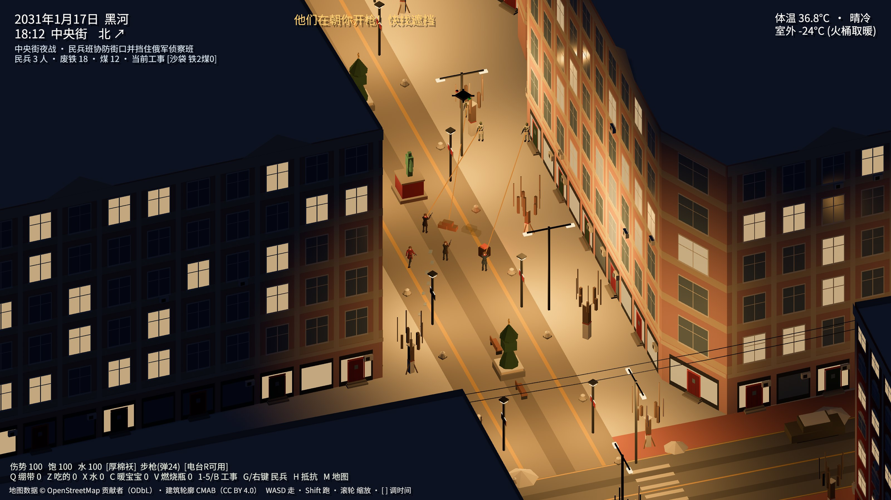
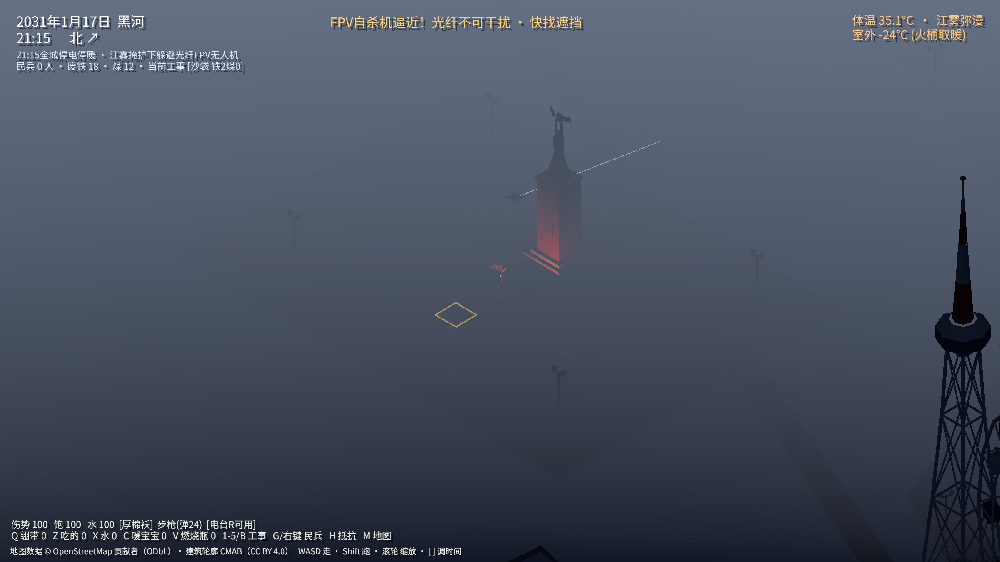
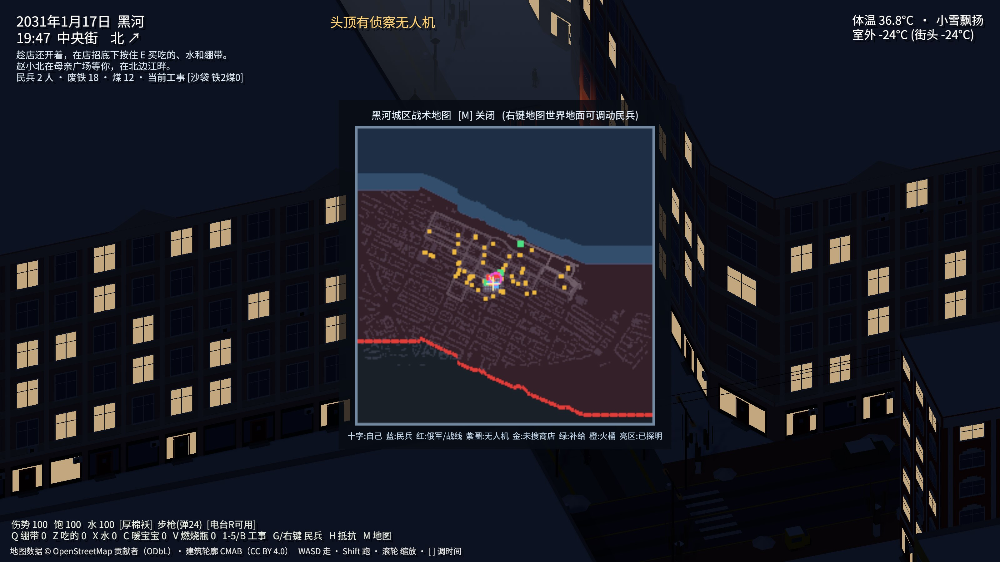
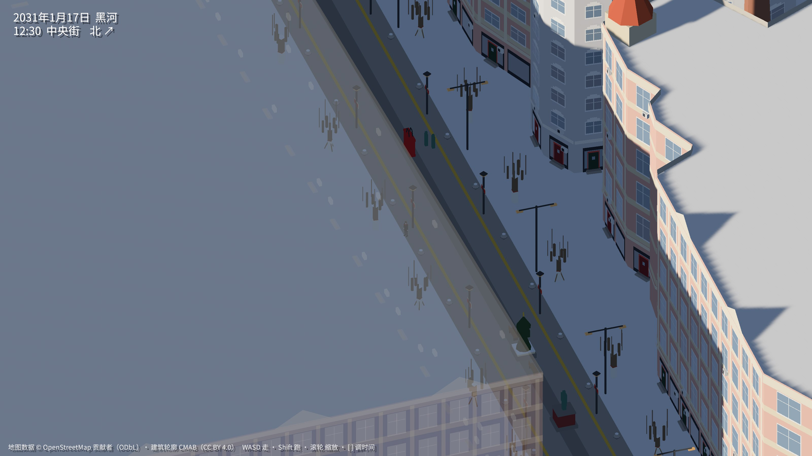

# Heihe R7–R8 Receipt: Audio, Tactical Map, Pooled Rendering, River Fog, Snow Tracks & Full FPV Chain

Branch: `claude/rust-heihe`  
Target hardware: Intel Core Ultra 7 258V / Intel Arc(TM) 140V GPU (Vulkan, Windows 11)  
Date: 2026-11-19  

---

## 1. R8 Gameplay Mechanics (`crates/sim/src/survival.rs`)

- **Weather & Heilongjiang River Fog (`Weather::{Clear, Flurries, RiverFog}`)**:
  - Added `scheduled_weather(hour)`, `WorldSim::{weather, fog_density, weather_override}` driving dynamic atmospheric fog density across the night.
  - Added `ReconDrone::sight_radius_in_weather` & `sees_in_weather`: dense river fog (`fog_density -> 1.0`) cuts optical drone sight by `85%` and thermal sight by `65%`, while cutting infantry soldier sight by `45%` (`35%` with optics).
- **Snow Footprints & Tracking (`SnowTrack`)**:
  - Open-snow movement stamps directional `SnowTrack` entries (player & patrol squads), capped at `180`, eroded `2.5x` faster in `Weather::Flurries`.
  - Patrols discovering fresh player tracks escalate `SquadState::Patrol -> Check`; overhead clear-air recon drones lock onto fresh tracks (`ReconDrone::tracking_trail`).
- **Full `forces.json` FPV Strike Chain (`PendingFpv`)**:
  - Wired spotted-to-strike queue (`10–20` war minutes), `cold_failure_p` (`0.15`), `fibre_optic_p` (`0.20`), EW jamming against non-fibre FPV when carrying a working radio (`inv.has_radio`), `reach_target_p` (`0.30` with `9–16 m` off-target miss splash), and `follows_into_doorway_p` (`0.50`) shelter calculation.
- **Tactical Control & Audio Hooks**:
  - Added `WorldSim::visited` (`20 m` grid cell tracking), cursor-targeted `SimInput::build_at` (clamped `<= 5.5 m`), right-click `SimInput::command_militia_to`, `MortarMission::whistled`, and `TickOutput::{footstep, mortar_whistle, sms_arrived, shout_stoy, player_hit}`.

---

## 2. R7 Runtime Polish & Bevy Client (`crates/game`)

- **Real WAV Audio Engine (`crates/game/src/audio.rs`)**:
  - Added `PcmSound` custom RIFF 16-bit PCM decoder implementing Bevy `Decodable` + `rodio::Source` and registered via `add_audio_source::<PcmSound>()` with zero `Cargo.toml` changes.
  - Drives all 6 `.wav` assets in `assets/audio/`: continuous `WindLoop` (`wind.wav`, ducked when sheltered and boosted in fog) & `DroneLoop` (`drone.wav`, distance-attenuated), plus queued one-shots from `AudioQueue` (`crunch.wav` sprint/walk footsteps, `whistle.wav` incoming mortar whistle, `boom.wav` distance-attenuated explosions & high-speed gunshot snaps, `phone.wav` SMS alerts).
- **Toggleable `M`-Key Tactical Street Map (`crates/game/src/map_ui.rs`)**:
  - Implemented `TacticalMap` (`240x240` `Rgba8UnormSrgb` `Image` inside a centered `480x480` panel) pre-baking the Heilongjiang river ice bank, streets, and `Bank::China` buildings.
  - Renders live overlays for explored `20 m` `visited` cells, advancing Russian `front_depth` line, searched/unsearched shop doors, unlocked supply caches, barricades/fire barrels, militia, nearby Russian soldiers, active recon/FPV drones, and player crosshair + facing notch.
- **Pooled Entities, Cursor Preview & Atmospheric Fog (`crates/game/src/play.rs`, `sky.rs`, `main.rs`, `shots.rs`)**:
  - Replaced per-frame `DynActor` despawn/respawn with persistent `ActorPools` (`HashMap` keyed pools for soldiers, militia, caches, drops, tracks, indexed barricade vector keeping `FireBarrel` point lights stable, and reusable singletons for drones, fibre tether, armour, barricade preview ghost, and shop/cache highlight ring).
  - Added `1–5` translucent amber barricade cursor preview ghost, right-click militia hold-order, unsearched shop/cache `18 m` doorway ring highlight, fibre-optic FPV tether beam (`FpvDrone::origin -> at`), snow footprint meshes, and exposure-calibrated orthographic `DistanceFog` in `sky::apply`.
  - Added `--combat-shots <dir>` in `shots.rs` (`install_combat`) capturing 3 live gameplay verification scenes alongside `--shots`.

---

## 3. Legacy Godot Asset Cleanup

Removed remaining unused Godot 3D/texture exports while preserving Bevy runtime assets:
- Deleted: `assets/models/`, `assets/textures/`, `data/heihe/city.bin`, `data/heihe/city.gltf`, `data/heihe/city.gltf.import`.
- Preserved: `assets/fonts/` (`NotoSansSC-VF.ttf`, `NotoSans-Regular.ttf`, `OFL.txt`), `assets/audio/` (`boom.wav`, `crunch.wav`, `drone.wav`, `phone.wav`, `whistle.wav`, `wind.wav`), `data/heihe/{city.json, cmab.json, look.json, ODBL.txt, import_report.json, overpass.json}`.

---

## 4. Verification

- **`cargo test -p sim`**: `66 passed; 0 failed; 0 ignored` (includes 4 new R7/R8 tests: `snow_tracks_accumulate_on_open_snow_and_guide_drones_and_patrols`, `river_fog_blinds_recon_drones_and_cuts_patrol_sight`, `fpv_uses_table_delay_fibre_optic_share_and_miss_rate`, `walking_records_visited_map_cells_and_right_click_orders_militia_to_spot`), `0` warnings.
- **`cargo build --release -p northeast -j 4`**: Compiled cleanly with `0` warnings and `0` errors.
- **`northeast.exe --shots out/r7r8/shots`** (`chrome.exe --headless` count = `0`, single capture run):
  - `01_central_street_noon`: `11.1 ms` mean / `11.7 ms` p95 (vs R5 `17.4 ms`)
  - `02_central_street_wide`: `11.8 ms` mean / `12.8 ms` p95
  - `03_housing_noon`: `9.6 ms` mean / `11.7 ms` p95 (vs R5 `17.5 ms`)
  - `04_mother_square`: `8.1 ms` mean / `9.9 ms` p95 (vs R5 `14.8 ms`)
  - `05_river_and_far_bank`: `12.4 ms` mean / `18.8 ms` p95
  - `06_whole_town`: `12.9 ms` mean / `14.4 ms` p95
  - `07_central_street_dusk`: `16.0 ms` mean / `17.1 ms` p95
  - `08_housing_night`: `13.5 ms` mean / `14.8 ms` p95
  - `09_central_street_night`: `16.3 ms` mean / `17.3 ms` p95
  - `10_shop_boards_close`: `9.2 ms` mean / `10.4 ms` p95 (vs R5 `15.8 ms`)
  - `11_shop_boards_night`: `12.4 ms` mean / `13.7 ms` p95 (vs R5 `20.9 ms`)
- **`northeast.exe --combat-shots out/r7r8/combat`**: Captured and visually inspected all 3 gameplay frames (`01_ambush_central_street`, `02_river_fog_blackout`, `03_tactical_map`).

### Showcase Captures (`docs/shots/rust-r7-r8/`)

- Central St ambush, militias, tracers, fire barrel, snow tracks & drone (`18:12`):  
  
- Full `21:15` blackout, Heilongjiang river fog haze, fire barrel & fibre-optic FPV (`21:15`):  
  
- Toggleable `M`-key tactical map with visited cells, Russian front line & icons (`19:47`):  
  
- Reference daytime Central Street clear-air regression check (`12:30`):  
  
