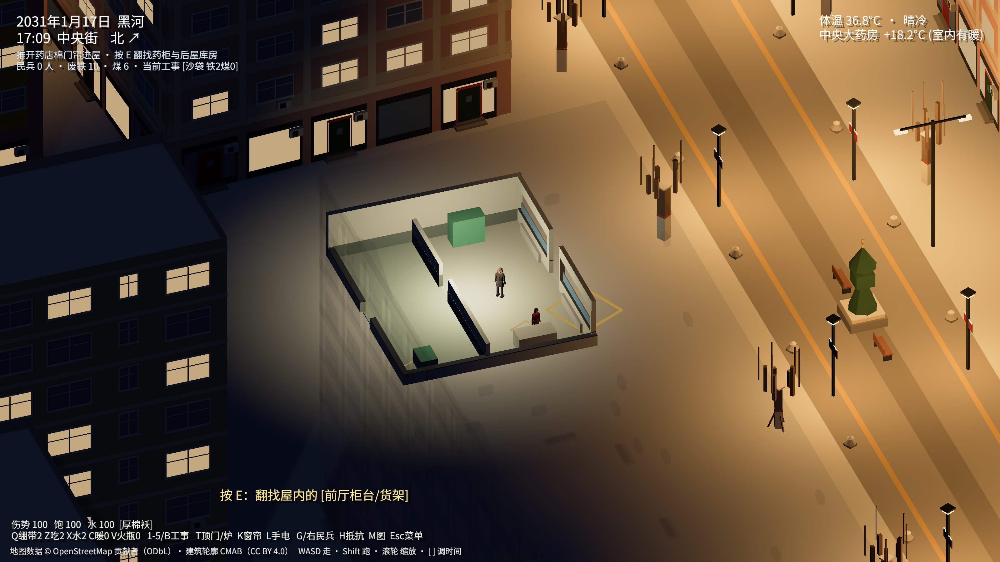
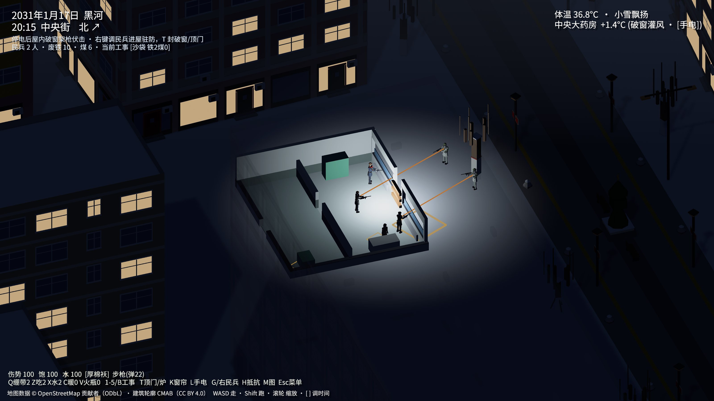
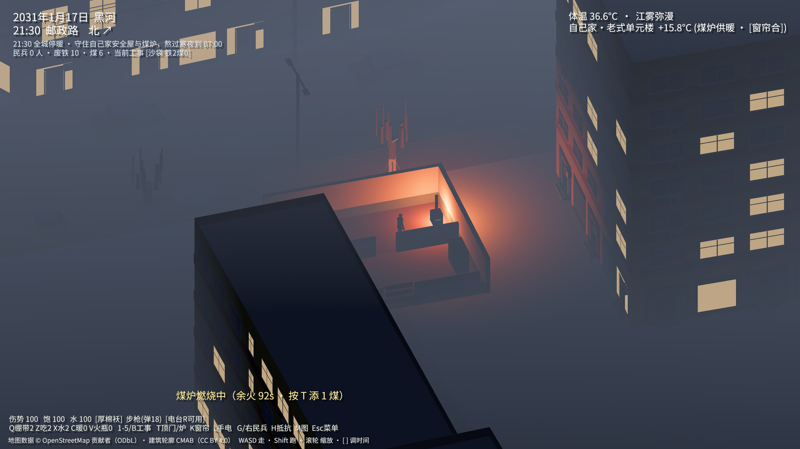
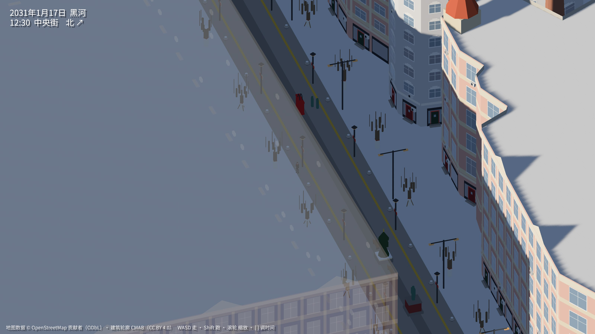

# Heihe R9–R10 Receipt: Seamless Ground-Floor Interiors, Safehouses & Basement

Branch: `claude/rust-heihe`  
Target hardware: Intel Core Ultra 7 258V / Intel Arc(TM) 140V GPU (Vulkan, Windows 11)  
Date: 2026-11-19  

---

## 1. Procedural Ground-Floor Interiors & Cutaway Geometry (`crates/sim/src/interior.rs`)

- **Enterable Building Selection (`build_interiors`)**:
  - Generates `10–14` enterable `Bank::China` buildings seated strictly inside OSM/CMAB building footprints with verified street/alley doorway clearances.
  - Guarantees key narrative & survival spaces across Heihe:
    - `InteriorKind::PlayerHome` (`自己家·老式单元楼`, steel security door, coal stove, stocked home stash locker)
    - `InteriorKind::NeighbourHome` (neighbour flat)
    - `InteriorKind::BasementShelter` (`room_temp_c = 4.0°C` masonry shelter)
    - `InteriorKind::Pharmacy` (Central St pharmacy)
    - Signed Central St shops (`Food`, `Drink`, `Clothes`, `Hardware`, `Hotel`, `Shop`), several with through-building `back_door` alley exits.
- **Room Layout & Architectural Cutaway (`InteriorMesh`, `RoomZone::{FrontHall, BackRoom, Basement}`)**:
  - Local room collision volumes (`LocalBox` with `contains`, `push_out`, `segment_hits`), `RoomDoor`, `RoomWindow`, `RoomLoot`, `RoomNpc`, and `HomeStash`.
  - Cutaway geometry built around floor tiles (`y = 0.01..0.07`), `0.64 m` cutaway knee-walls facing SE (`CAM_DIR = (0.7071, -0.7071)`), full back walls, `1.48 m` interior partition dividers, cast-iron radiators, role-specific furniture, window glass/boards, movable curtains, door barricade planks, and exterior `棉门帘` cotton doorway curtains / steel residential doors.

---

## 2. Indoor Navigation, Stealth, Thermal Simulation & Siege Mechanics (`crates/sim/src/walk.rs`, `survival.rs`)

- **Seamless Walk & Line-of-Sight (`crates/sim/src/walk.rs`)**:
  - Added `Ground::new_with_interiors(city, interiors)` mapping `enterable: HashMap<u32, usize>`, `step_with_interiors`, and `clear_line_with_interiors` (supporting `ignore_curtains` for mortar/blast vs optical sight) while keeping `Ground::new`, `step`, and `clear_line` backwards-compatible.
- **Indoor State & Controls (`crates/sim/src/survival.rs`)**:
  - Added `SimInput::{toggle_flashlight, toggle_curtains, fortify_or_stove}`, `TickOutput::{door_action, door_breach_thud, glass_break}`, and `WorldSim::{interiors, active_interior, cutaway_interior, flashlight_on, home_visited, current_room_temp, active_interior_name}`.
  - **Thermodynamics & Utilities**: Before `21:00` district heating maintains warm shop/flat interiors; after `21:00` municipal heat shuts off while `PlayerHome` coal stove / fire barrels (`fortify_or_stove` with `T`) reheat rooms, and `18 m` mortar blasts (`shatter_windows_near`) break unboarded glass causing cold wind chill until boarded (`T`).
  - **Stealth, Curtains & Breaching**: Unlit indoor rooms after `19:30` blackout cut enemy detection (`0.22x`); drawing curtains (`K`) occludes outside line-of-sight; barricading doors (`T`) blocks entry until patrolling Russian soldiers breach `barricade_hp` (`12.0 hp/s`).
  - **Zone Shelter & Militia Defense**: `Basement` gives `0.0x` mortar damage and immunity to FPV strikes; `BackRoom` gives `0.08x` mortar damage and immunity to FPV strikes; `FrontHall` gives `0.22x` mortar damage with conditional FPV follow. Added `MilitiaOrder::Garrison` for holding window firing positions indoors (`step_combat_actions`, `step_militia`).

---

## 3. Bevy Rendering, Roof Peel-Back, Pooled Lighting, Audio, Map & Menus (`crates/game`)

- **Roof & Exterior Cutaway (`crates/game/src/main.rs`)**:
  - Initialized `Ground::new_with_interiors(&city, &sim::interior::build_interiors(&city))`.
  - Extended `Cut` shader material / cut state with `building_id` and `peeled` so `cut_away` cleanly hides `Solid` and `Window` meshes of `WorldSim::cutaway_interior`.
- **Pooled Interior Visuals & Dynamic Lighting (`crates/game/src/play.rs`)**:
  - Added `InteriorPart`, `IndoorLightKind::{Room, Stove, Flashlight}`, `InteriorVisualSet`, `InteriorVisuals`, and extended `ActorPools` with `room_npcs` and `room_loots`.
  - Spawns cutaway meshes for the active/peeled building plus exterior `棉门帘` portals across enterable storefronts, 3 pooled dynamic lights (room ceiling, coal stove ember glow, directional player flashlight), `y = 0.07` indoor elevation, keybinds `L` (flashlight), `K` (curtains), `T` (barricade / board window / stoke stove), and live HUD indicators (`room_temp_c`, room name, `[窗帘合]` / `[手电]`).
- **Muffled Indoor Audio (`crates/game/src/audio.rs`)**:
  - Added `AudioState::{indoor_sealed, indoor_broken}` ducking `WindLoop` (`0.04` in sealed interiors, `0.16` when windows are broken) plus `AudioQueue::{door_action, door_thud, glass_break}`.
- **Tactical Map, Controls Menu & Shot Harness (`map_ui.rs`, `menu_ui.rs`, `shots.rs`)**:
  - `TacticalMap` (`crates/game/src/map_ui.rs`) renders enterable buildings (`[72, 198, 212]`), `PlayerHome` (`[255, 224, 78]` gold ring), `BasementShelter` (`[95, 238, 255]`), and `NeighbourHome` (`[125, 240, 145]`).
  - `ControlsMenuRoot` (`crates/game/src/menu_ui.rs`) documents `L / K` (手电筒 / 窗帘), `T` (顶门/封窗/煤炉), and `G / 右键` indoor Garrison orders.
  - Added `--interior-shots <dir>` in `crates/game/src/shots.rs` (`install_interior`) capturing 3 indoor verification views alongside the 11-shot city regression sweep.

---

## 4. Verification

- **`cargo test -p sim --quiet`**: `72 passed; 0 failed; 0 ignored` (includes 6 new R9–R10 tests: `enterable_interiors_include_shops_home_neighbour_and_basement`, `front_in_back_out_walking_and_indoor_wall_collision`, `barricaded_door_blocks_and_russian_patrol_breaches_over_time`, `blackout_stealth_curtains_broken_window_chill_and_coal_stove_heat`, `backroom_and_basement_block_mortar_and_fpv_strikes`, `home_stash_and_militia_garrison_work_indoors`), `0` warnings.
- **`cargo build --release -p northeast -j 4`**: Compiled cleanly with `0` warnings and `0` errors (`target/x86_64-pc-windows-gnullvm/release/northeast.exe`, `102.59 MB`).
- **`northeast.exe --interior-shots out/r9r10/interiors`** (`chrome.exe --headless` = `0`): Exited `0`. Inspected all 3 PNGs:
  - `01_shop_interior_lit.png` (`17:09 中央大药房 +18.2°C`): Clean roof peel, shopkeeper behind counter, shelves, radiators, partition wall, backroom crates, golden `room_loots` ring.
  - `02_blackout_ambush_indoor.png` (`20:15`): Blackout street, flashlight beam, broken front window, barricaded door planks, 2 `Garrison` red-armband militia returning tracer fire against Russian soldiers on snow.
  - `03_player_home_stove.png` (`21:30 邮政路 · 自己家·老式单元楼 +15.8°C (煤炉供暖 · [窗帘合])`): River fog outside, drawn red curtains, barricaded steel door, coal stove amber hearth glow over bed/desk/locker.
- **`northeast.exe --shots out/r9r10/shots`** (11-shot exterior & `棉门帘` regression benchmark):
  - `01_central_street_noon`: `mean 19.2 ms` (`p95 21.2 ms`)
  - `02_central_street_wide`: `mean 19.8 ms` (`p95 22.3 ms`)
  - `03_housing_noon`: `mean 18.8 ms` (`p95 20.8 ms`)
  - `04_mother_square`: `mean 16.6 ms` (`p95 18.9 ms`)
  - `05_river_and_far_bank`: `mean 24.8 ms` (`p95 28.3 ms`)
  - `06_whole_town`: `mean 29.2 ms` (`p95 35.6 ms`)
  - `07_central_street_dusk`: `mean 23.8 ms` (`p95 26.2 ms`)
  - `08_housing_night`: `mean 18.1 ms` (`p95 19.7 ms`)
  - `09_central_street_night`: `mean 21.7 ms` (`p95 23.3 ms`)
  - `10_shop_boards_close`: `mean 11.3 ms` (`p95 13.2 ms`)
  - `11_shop_boards_night`: `mean 14.2 ms` (`p95 15.7 ms`)

### Showcase Captures (`docs/shots/rust-r9-r10/`)

- Lit pharmacy cutaway interior, counter NPC, radiator & loot highlights (`17:09`):  
  
- Post-blackout indoor ambush with flashlight, broken glass, barricaded door & militia Garrison (`20:15`):  
  
- Player home steel door, drawn curtains & coal stove hearth glow in dense river fog (`21:30`):  
  
- Exterior Central Street daytime regression check with `棉门帘` doorway portals (`12:30`):  
  
